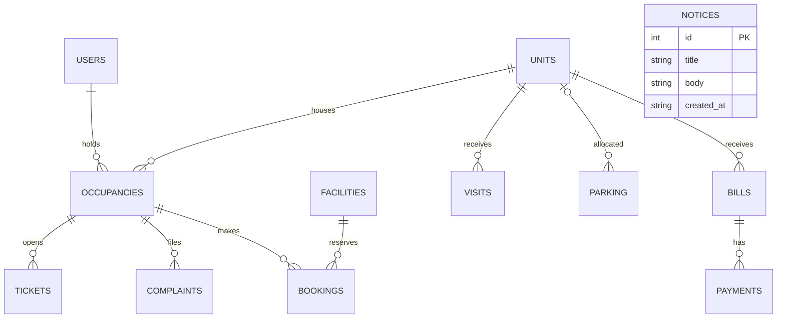

# Presentation and viva guide

**Aditi M Hubli · PES1UG24CS652**

**Fathima Zahra · PES1UG24CS664**

## Suggested presentation sequence

| Slide | What to show |
|---|---|
| 1 · Title | AptEase Apartment Management System, team members and SRNs. |
| 2 · Problem | Separate registers make it hard to find a unit’s current occupants, payment balance and pending requests. |
| 3 · Actors and features | Administrator, resident and gate staff. Walk through each role’s two or three most important actions. |
| 4 · ER diagram | Explain occupancy as a relationship between a user and an apartment. Trace the bill-to-payment and facility-to-booking relationships. |
| 5 · Three database types | Explain SQL constraints and transactions, nested TinyDB contacts, and cosine similarity over help-article vectors. |
| 6 · Live demo | Follow the script below using a fresh local database. |
| 7 · Scope | Describe the local demo, manual payment recording and possible extensions such as payment-gateway reconciliation and notifications. |

A suggested speaking split is for Aditi to cover the problem, ER diagram and billing, and for Fathima to cover role permissions, the operational demo and scope. Adjust this to match your actual contributions.

## ER diagram



Notices are community-wide. Each parking slot can be unassigned or assigned to one unit. A resident can have many historical occupancies, with at most one current occupancy. A unit can house multiple residents.

## Live demo

1. Sign in as `admin`. Add A-101 in **Units & residents**, add a facility and create a parking slot. Sign out and select **Create a resident account**. Choose Tenant and A-101, then create an account with fictional details. Sign back in as admin, approve the request, and show the occupancy history.
2. Open **Maintenance dues**. Issue a ₹3,500 bill for A-101 and record ₹1,000 using reference `DEMO-PART-001`. Show its ₹2,500 balance. Try ₹2,501 with another reference and show the trigger rejection.
3. Sign out and sign in with the approved resident account. Verify that the balance is visible. Submit a service request. Reserve a facility for a future date and try the same facility, date and time again to show conflict prevention.
4. Sign in as `guard`. Check a fictional visitor into A-101 and show the dashboard count. Check the visitor out and show their departure time.
5. Return to `admin`. Set the service request to **In progress**, allocate a parking slot, and publish a notice. If time permits, return as `resident` and show the updates.
6. As the resident, open **Complaints** and file a noise complaint. As `admin`, write a management response and set its status to **In progress**. Return as the resident to show the response and status.
7. As `admin`, add a contact in **Community directory** and show it as a resident. In **Help search**, search for `neighbors are too loud` and point out the returned complaints article and similarity score.

## SQL examples

Run these in a SQLite client after opening the database file, or start the Python SQLite shell with `python -m sqlite3 aptease.sqlite3` on Python 3.12 or newer.

```sql
-- Occupancy by apartment, including empty units.
SELECT u.block, u.number, COUNT(o.id) AS current_residents
FROM units AS u
LEFT JOIN occupancies AS o ON o.unit_id = u.id AND o.end_date IS NULL
GROUP BY u.id
ORDER BY u.block, u.number;

-- Outstanding dues by apartment in rupees.
SELECT u.block, u.number, SUM(b.balance) / 100.0 AS outstanding_rupees
FROM bill_balances AS b JOIN units AS u ON u.id = b.unit_id
WHERE b.balance > 0
GROUP BY u.id
ORDER BY outstanding_rupees DESC;

-- Visitors currently on site.
SELECT v.visitor, u.block, u.number, v.arrived_at
FROM visits AS v JOIN units AS u ON u.id = v.unit_id
WHERE v.departed_at IS NULL
ORDER BY v.arrived_at;
```

## Viva preparation

- **Why separate bills and payments?** One bill can have multiple receipts. Storing each receipt separately preserves the ledger and avoids repeating bill details.
- **How is the balance calculated?** The view subtracts the aggregate of related payments from the billed amount. A left join includes unpaid bills.
- **Why use integer paise?** The database adds money exactly using integers. Currency amounts are converted to and from decimal rupees at the interface.
- **Why use a composite unique constraint?** A facility can be booked many times, but the same facility, date and starting hour can exist only once.
- **What happens if registration fails after the user row is inserted?** Both writes are in one transaction. If the occupancy insert fails, SQLite rolls back the user insert too.
- **How are repeated attributes avoided?** Unit, person and facility details have their own tables. Occupancies, bills, tickets and bookings refer to their parent rows by keys.
- **How is access checked?** Each protected route checks the signed-in role. Resident queries filter by current apartment or by the resident’s user ID, depending on the module. Form tokens protect state-changing requests.
- **Why three storage types?** SQL enforces relationships and business rules. TinyDB stores nested contact documents with optional attributes. sqlite-vec runs cosine nearest-neighbor queries against a separate vector database file using its `vec0` virtual table.
- **What does a vector represent here?** Each coordinate represents one apartment help topic. Query aliases such as “loud” and “complaint” activate the same topic. The system ranks the six built-in help articles by cosine similarity and shows up to three matches.
